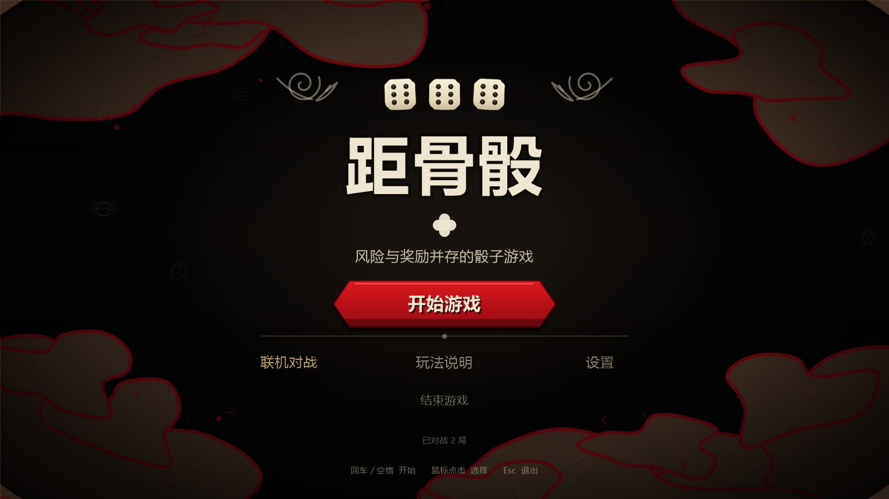
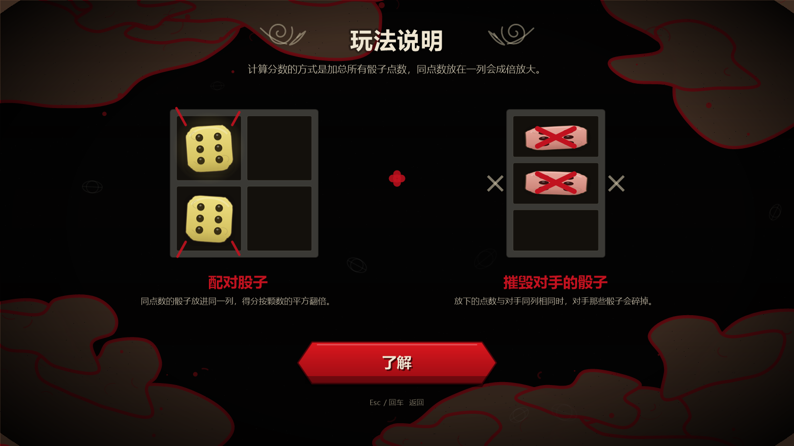
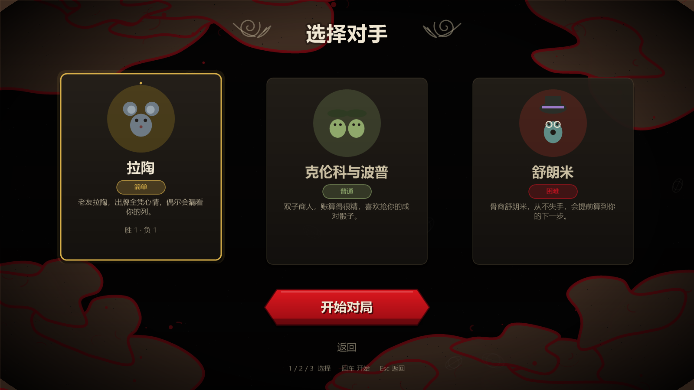
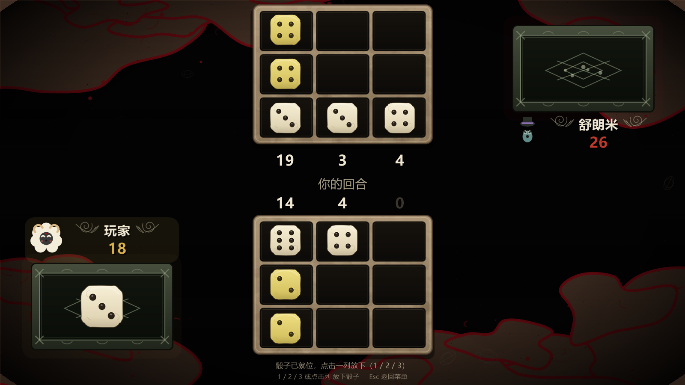
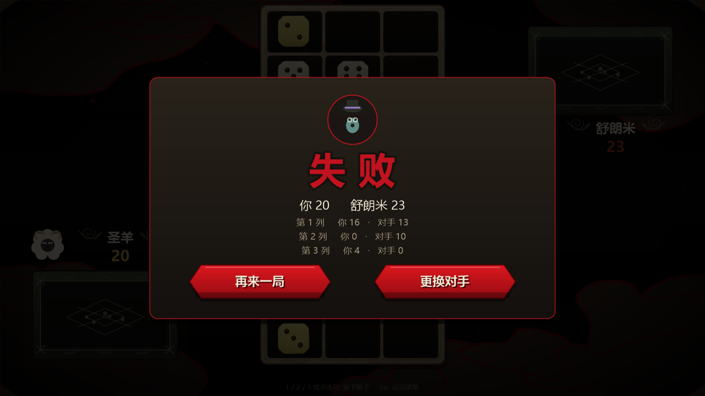
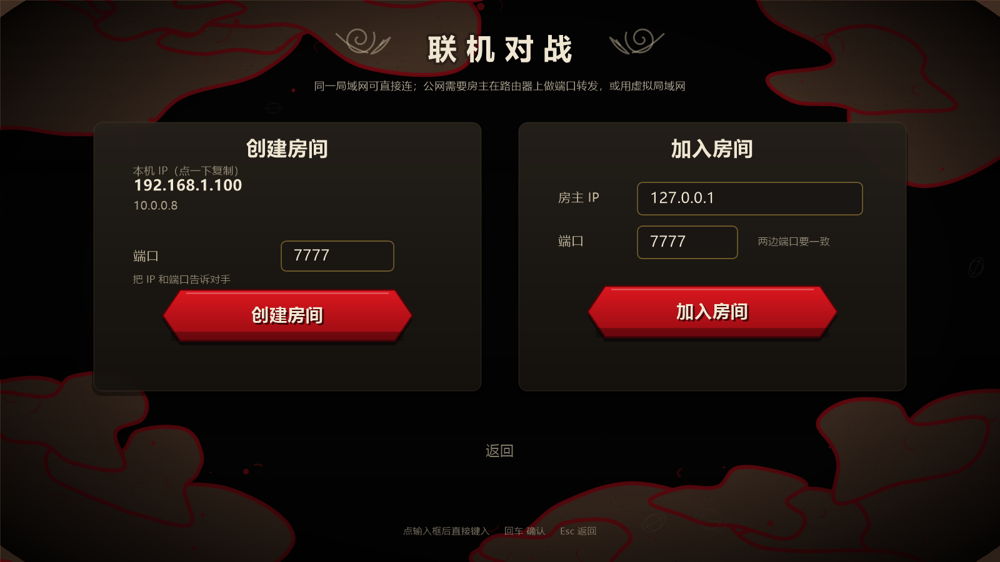
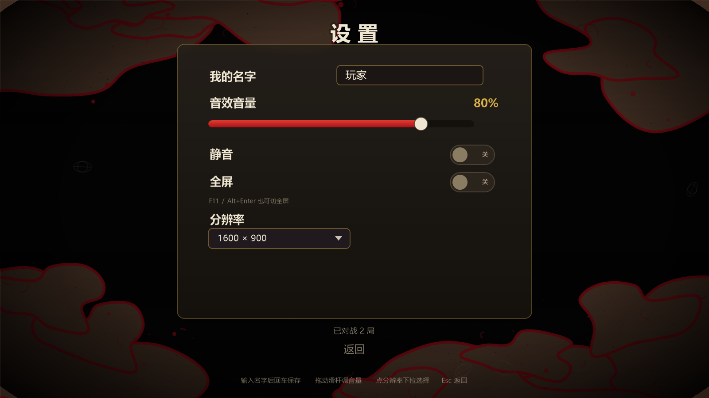
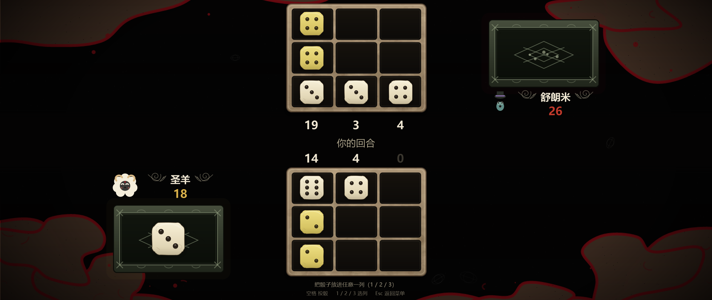
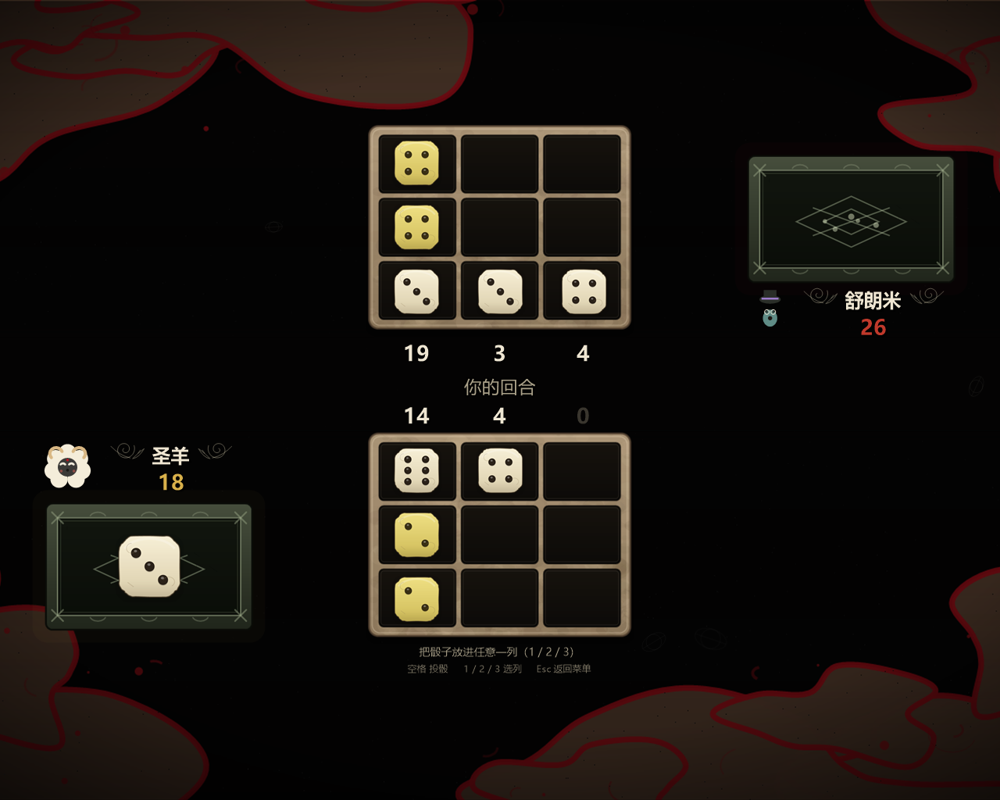

<div align="center">


# 距骨骰 · LambDice

用 **C# + WinForms** 从零复刻《咩咩启示录》里的骰子小游戏「距骨骰」。
**所有美术与音效都由代码实时生成**——没有一张图片、没有一个音频素材文件。

[](LICENSE)
[](https://dotnet.microsoft.com/)
[](#运行)
[](#美术是怎么画出来的)
[](#许可与声明)

</div>



---

## 特性

- 🎲 **规则还原**：3×3 棋盘、同点数摧毁、`Σ 点数×颗数²` 计分、先填满者结束
- 🤖 **三档 AI**：拉陶（乱放）、克伦科与波普（贪心）、舒朗米（贪心 + 一步预判）
- 🌐 **联机对战**：TCP 直连、房主权威同步、双方同意才能再来一局
- 🎨 **零素材**：血迹背景、骰子、骰盆、缎带、花纹、头像、音效全部由代码绘制/合成
- ⚡ **60 FPS**：文字/骰子/静态图层位图缓存 + 像素对齐合成（1080p 下 ≈87fps）
- 🖥️ **分辨率自适应**：1600×900 设计，等比缩放居中，背景 cover 铺满，支持全屏与自定义分辨率
- 💾 **本地记忆**：昵称、音量、静音、分辨率、窗口位置、对局战绩

## 运行

### 直接下载

到 [Releases](../../releases) 下载 `LambDice.exe`，双击运行。

需要 **.NET 6 桌面运行时**（[下载](https://dotnet.microsoft.com/download/dotnet/6.0)）。
不想装运行时的话，按下面的命令自己打包成自包含版本：

```bash
dotnet publish -c Release -r win-x64 --self-contained true \
  -p:PublishSingleFile=true -o publish-selfcontained
```

### 从源码运行

```bash
git clone <this-repo>
cd LambDice
dotnet run -c Release
```

## 玩法

双方各有一块 **3 列 × 3 格** 的棋盘，轮流投一颗六面骰并放进自己任意一列。

| 规则 | 说明 |
| --- | --- |
| 计分 | 单列 = `Σ 点数 × 该点数在本列出现的颗数²`，总分 = 三列之和 |
| 摧毁 | 放下的瞬间，移除对手**同一列**中所有**相同点数**的骰子 |
| 结束 | 任意一方先填满三列（9 颗）立即结束，总分高者胜，相同为平局 |
| 先手 | 随机，开局在两张棋盘中间提示「XX 先掷骰」 |

| 列内容 | 得分 |
| --- | --- |
| 6 | 6 |
| 6, 6 | 24 |
| 6, 6, 6 | 54 |
| 6, 6, 3 | 27 |

## 操作

| 操作 | 按键 |
| --- | --- |
| 放骰 | `1` / `2` / `3`，或直接点自己棋盘的某一列 |
| 返回 | `Esc` |
| 全屏 | `F11` 或 `Alt+Enter` |
| 联机大厅 | 点输入框直接键入，回车确认 |

> **投骰是自动的**：轮到谁，骰子会自己滚进各自的骰盆，你只需要决定放进哪一列。

## 界面

| 玩法说明 | 选择对手 |
| --- | --- |
|  |  |

| 对局 | 结算 |
| --- | --- |
|  |  |

## 联机对战

标题界面点「联机对战」：



- **房主**：端口默认 **7777**，点「创建房间」，把界面上的**本机 IP + 端口**告诉对手
- **加入方**：填房主 IP 和同一个端口，点「加入房间」
- 大厅会列出本机所有 IPv4 地址，**点一下复制**；上次用过的 IP 会自动填好

实现是 **TCP 直连 + 房主权威**：房主跑全部规则（投骰、摧毁、计分），每步广播整盘状态；
客人只发「放哪一列」，双方听到的音效、看到的动画完全一致。

- 局域网直接可玩；公网需要房主在路由器转发该 TCP 端口，或用 ZeroTier / Tailscale 之类的虚拟局域网
- 任意一方中途退出会断开连接，另一方回到标题并提示「与对手的连接已断开」
- 结算时**再来一局需要双方同意**：一方点「再来一局」，另一方也会看到提示，两边都点才开下一局
- 换昵称不用重连：设置里改的名字会在下一局同步给对手

## 设置



- **我的名字**：默认「玩家」，最多 8 个字，联机时对方看到的就是它
- **音效音量 / 静音**：滑杆可拖动，0–100%
- **全屏**：`F11` / `Alt+Enter` 亦可切换
- **分辨率**：下拉选择 `1280×720 / 1600×900 / 1920×1080`，客户区精确等于所选值
- **战绩**：每局结束自动记录对每个对手的胜负（联机不计）

配置保存在 `config.txt`（优先 `%LOCALAPPDATA%\LambDice`，写不进去则落在程序目录，绿色版友好）。

## 分辨率适配

界面按 **1600×900** 设计，运行时等比缩放居中，任何窗口比例都不拉伸、不裁切：

- 背景按 **cover** 铺满窗口，所以不会有黑边
- 通栏元素（对局横带、结算遮罩）跟着窗口宽度走
- 窗口可以随意拖拽缩放、拖到屏幕外也不会错位；大小与位置会被记住
- 最小窗口 960×540

| 21:9 带鱼屏 | 5:4 |
| --- | --- |
|  |  |

## 性能

所有画面都是代码绘制的矢量图形，为了跑满 60fps 做了这些优化：

| 优化 | 做法 |
| --- | --- |
| 文字缓存 | 字符串渲染成小位图缓存，避免每帧 `DrawString` |
| 骰子缓存 | 按显示像素生成骰面（256px 母版一次性高质量缩小） |
| 静态图层 | 标题柔光、对局横带、cover 背景只渲染一次并按尺寸缓存 |
| 像素对齐贴图 | 设计坐标换算成设备像素、取整后贴图，避免 GDI+ 对每张图重采样 |
| 单画布合成 | 背景 + 通栏 + 界面 + 覆盖层画进同一张窗口尺寸画布，最后一次 1:1 贴出 |

实测（`--bench`，ms/帧）：

| 分辨率 | 标题 | 对局 |
| --- | --- | --- |
| 1600×900 | 6.6 (151fps) | 8.3 (121fps) |
| 1920×1080 | 9.4 (107fps) | 11.4 (88fps) |
| 2560×1440 | 14.6 (68fps) | 17.8 (56fps) |

## 美术是怎么画出来的

全部在 [`Ui/Art.cs`](Ui/Art.cs) 里用 GDI+ 现场绘制并按尺寸缓存：

| 元素 | 画法 |
| --- | --- |
| 背景 | 纯黑底 + 四角不规则「干血块」（闭合样条 + 红色描边）+ 飞溅点 + 暗角 + 细颗粒 |
| 棋盘 | 米色渐变 + 数百个半透明斑块做旧 + 手绘感粗描边，再挖 9 个黑格 |
| 骰子 | 抖动圆角矩形 + 渐变 + 内高光 + 深色描边；成对变黄、三连变蓝、被摧毁变粉 |
| 骰盆 | 深橄榄色框 + 双层刻蚀线 + 四角 X + 菱形符文 + 裂纹 |
| 缎带按钮 | 两端缺口的多边形 + 红色渐变 + 顶部高光 + 底部折边 |
| 花纹 / 徽记 | 贝塞尔长尾 + 参数化螺旋 + 叶片；四个圆瓣合并成骨节 |
| 头像 | 羊头（羊毛团 + 黑脸 + 闭眼 + 羊角）、老鼠、双子、青绿商人 |
| 音效 | [`Ui/Sfx.cs`](Ui/Sfx.cs) 合成 WAV：噪声瞬态 + 三个高频谐振 + 低频撞击体 |

## 工程结构

```
LambDice/
  Program.cs              入口 + 自测命令（截图 / 自动对局 / 联机 / 性能 / 图标）
  App.cs                  窗口、渲染管线（单画布合成）、输入、分辨率与全屏
  Game/Core.cs            棋盘、计分、摧毁、对局状态
  Game/Ai.cs              三位对手与三档 AI
  Net/NetSession.cs       TCP 直连 + 行分隔 JSON，房主权威
  Ui/Theme.cs             配色、字体、文字位图缓存
  Ui/Art.cs               全部程序化美术
  Ui/Sfx.cs               程序化音效
  Ui/Blit.cs              设备像素对齐贴图
  Ui/Config.cs            配置与战绩持久化
  Ui/TextField.cs         自绘输入框
  Screens/                标题 / 玩法说明 / 选择对手 / 大厅 / 设置 / 对局
  Shots/                  截图
  icon.ico, icon.png      程序图标（同样由代码生成）
```

## 自测命令

```bash
# 截图（--size 可指定任意分辨率）
LambDice.exe --shot Shots/match.png --screen match --moves 9 --seed 4242 --size 2560x1080

# AI 自动对局
LambDice.exe --auto out.txt --games 5

# 用真实界面跑一局（AI 代打，验证状态机与渲染）
LambDice.exe --autoplay out.txt

# 联机自测（两个进程）
LambDice.exe --nethost host.txt --port 7813
LambDice.exe --netjoin <房主IP> guest.txt --port 7813

# 性能测试
LambDice.exe --bench --screen match --w 1920 --h 1080

# 点击 / 拖动 / 裁切回归
LambDice.exe --click --screen title --click-x 800 --click-y 548
LambDice.exe --drag --x1 500 --x2 1000
LambDice.exe --cliptest

# 重新生成图标 / 导出音效
LambDice.exe --makeicon icon.ico
LambDice.exe --sfxdump sfx
```

## 常见问题

**Q：双击没反应 / 提示缺少 .NET？**
装 [.NET 6 桌面运行时](https://dotnet.microsoft.com/download/dotnet/6.0)，或按上面的命令打包自包含版本。

**Q：联机连不上？**
先确认两边端口一致（默认 7777）；局域网内检查 Windows 防火墙是否放行了该端口；公网需要在房主路由器做 TCP 端口转发。

**Q：画面在带鱼屏上有黑边？**
不会——背景是 cover 铺满的。如果看到黑边，说明跑的是旧版本，重新下载即可。

**Q：会加移动端 / 网络匹配吗？**
目前只做 Windows 桌面直连，没有匹配服务器。

## 许可与声明

代码以 **MIT** 协议开源，详见 [LICENSE](LICENSE)。

> 本项目是非官方的同人复刻作品，与 Massive Monster / Devolver Digital 无任何关联，也未获授权。
> 《咩咩启示录 / Cult of the Lamb》及其角色、名称、世界观归原作者所有。
> 仓库内**不包含任何来自原作的美术或音频素材**——所有贴图、精灵、音效与图标都是代码运行时生成的。
> 仅供学习交流，请勿用于商业用途。

## 致谢

- 玩法与美术风格致敬 **Massive Monster / Devolver Digital** 的《咩咩启示录》
- 三位对手的角色名来自原作：拉陶 / 克伦科与波普 / 舒朗米
